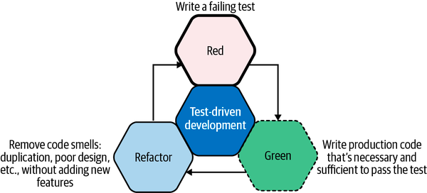

#  Python Unit Testing - Part 2

| Title                        | Type   | Duration | Author               |
|------------------------------|--------|----------|----------------------|
| Python Unit Testing - Part 2 | Lesson | 2:00     | Suresh Melvin Sigera |

## Objectives

*After this lesson, students will be able to:*

- Explain the importance of TDD
- Become familiar with TDD's three phases

### What is TDD (Test Driven Development)?

Test-driven development follows a three-phase process:

- **Red**. We write a failing test (including possible compilation failures). We run the test suite to verify the
  failing
  tests.

- **Green**. We write just enough production code to make the test green. We run the test suite to verify this.

- **Refactor** (Blue). We remove any code smells. These may be due to duplication, hardcoded values, or improper use of
  language idioms (e.g., using a verbose loop instead of a built-in iterator). If we break any tests during refactoring,
  we prioritize getting them back to green before exiting this phase.



The three phases of this cycle are the essential building blocks of test-driven development.

Note : TDD is a perfect match for the ideals and principles of the Agile Development process, with a great striving to
deliver incremental updates to a product with true quality, as opposed to quantity. The confidence in your individual
units of code that unit testing provides means that you meet this requirement to deliver quality, while eradicating
issues in your production environments.

### Agile Development With Test-Driven Development

TDD comes into its own when pair programming, however. The ability to mix up your development workflow, when working as
a pair as you see fit, is nice. For example, one person can write the unit test, see it pass, and then allow the other
developer to write the code to make the test pass.

### Syntax for Unit Testing

There is a list of assert statements available
on [this page](https://docs.python.org/3/library/unittest.html#assert-methods) that you can use as per your
requirements. Below is a list of some of the most common assert statements.

| Method                      | Checks for               |
|-----------------------------|--------------------------|
| `assertEqual(a, b)`         | a `==` b                 |
| `assertNotEqual(a, b)`      | a `!=` b                 |
| `assertTrue(x)`             | `bool(x)` `is` `True`    |
| `assertFalse(x)`            | `bool(x)` `is` `False`   |
| `assertIs(a, b)`            | a `is` b                 |
| `assertIsNot(a, b)`         | a `is` `not` b           |
| `assertIsNone(x)`           | x `is` `None`            |
| `assertIsNotNone(x)`        | x `is` `not` `None`      |
| `assertIn(a, b)`            | a `in` b                 |
| `assertNotIn(a, b)`         | a `not` `in` b           |
| `assertIsInstance(a, b)`    | `isinstance(a, b)`       |
| `assertNotIsInstance(a, b)` | `not` `isinstance(a, b)` |

### Installing and Using Python's Nose

Before starting the exercises below, you will need to install the `nosetest` test runner package. Installation of the
`nosetest` runner is straightforward, following the standard "pip" install pattern. It's also usually a good idea to
work on your projects using virtualenv's, which keeps all the packages you use for various projects separate.

The pip install is as easy as running this line:

```text
pip install nose
```

Once installed, you can execute a single test file.

```text
$ nosetests example_unit_test.py
```

Or execute a suite of tests in a folder.

```text
$ nosetests /path/to/tests
```

The only standard you need to follow is to begin each test's method with `test_` to ensure that the `nosetest` runner
can
find your tests!

Some useful command line options that you may wish to keep in mind include:

- `-v` gives more verbose output, including the names of the tests being executed.
- `-s` or `-nocapture` allows output of print statements, which are normally captured and hidden while executing tests.
  Useful for debugging.
- `--nologcapture` allows output of logging information.
- `--rednose` an optional plugin, which can be downloaded here, but provides colored output for the tests.
- `--tags=TAGS` allows you to place an `@TAG` above a specific test to only execute those, rather than the entire test
  suite.

### Further Reading

This section provides more resources on the topic if you are looking to go deeper.

- 
